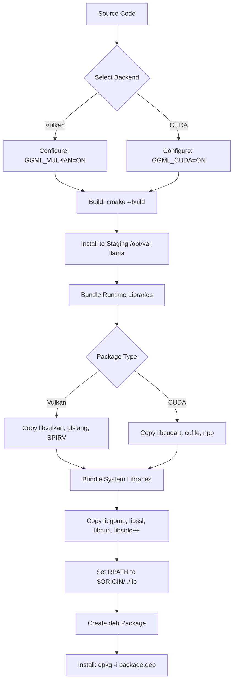

# VAI-LLAMA .deb Package Plan

## Overview

Create two self-contained .deb packages installed to `/opt/vai-llama`:

1. **llama-cpp-vulkan** - Vulkan GPU inference package
2. **llama-cpp-cuda** - NVIDIA CUDA GPU inference package

Both packages bundle all runtime libraries so target systems require **no additional GPU driver packages** beyond the actual NVIDIA/Vulkan device drivers that must be present on the host kernel level.

## Target Installation Structure

```
/opt/vai-llama/
├── bin/
│   ├── llama-cli              # Main CLI inference tool
│   ├── llama-server           # HTTP REST server
│   ├── llama-bench            # Benchmarking tool
│   ├── llama-quantize         # Quantization tool
│   ├── llama-batched-bench    # Batched benchmark
│   ├── llama-completion       # Legacy completion
│   ├── llama-perplexity       # Perplexity measurement
│   ├── llama-tokenize         # Tokenization tool
│   ├── llama-parser           # Parser tool
│   ├── llama-export-lora      # LoRA export
│   ├── llama-cvector-generator
│   ├── llama-gguf-split       # GGUF splitting
│   ├── llama-imatrix          # Input matrix tool
│   ├── llama-results          # Results tool
│   ├── llama-tts              # Text-to-speech
│   ├── convert_hf_to_gguf.py  # HF model converter
│   └── tools.sh               # Unified entrypoint script
├── lib/
│   ├── libggml.so             # Core GGML library
│   ├── libggml-base.so        # GGML base library
│   ├── libllama.so            # Core llama library
│   ├── libllama-common.so     # Common utilities library
│   ├── ggml/
│   │   ├── ggml-cpu.so        # CPU backend (auto-loaded)
│   │   ├── ggml-vulkan.so     # Vulkan backend (Vulkan package only)
│   │   └── ggml-cuda.so       # CUDA backend (CUDA package only)
│   ├── libvulkan.so.1         # Vulkan loader (bundled)
│   ├── libglslang.so*         # Vulkan shader compiler (bundled)
│   ├── libSPIRV.so*           # SPIR-V library (bundled)
│   ├── libOpenCL.so*          # OpenCL ICD (Vulkan dependency)
│   ├── libgomp.so.1           # OpenMP runtime
│   ├── libssl.so*             # OpenSSL (for HTTPS)
│   ├── libcrypto.so*          # OpenSSL crypto
│   ├── libcurl.so*            # cURL (for downloads)
│   ├── libpthread.so.1        # POSIX threads
│   ├── libstdc++.so.*         # C++ standard library
│   ├── libgcc_s.so.*          # GCC runtime
│   ├── libcudart.so.*         # CUDA runtime (CUDA package only)
│   ├── libcuda.so.*           # NVIDIA CUDA driver interface (CUDA package only)
│   ├── libnvml.so*            # NVIDIA Management Library (CUDA package only)
│   ├── libnvinfer.so*         # TensorRT (if needed)
│   ├── libcublas.so.*         # cuBLAS (bundled or runtime)
│   ├── libcufile.so*          # CUDA File I/O (bundled or runtime)
│   └── liburing.so*           # io_uring (if linked)
├── include/
│   ├── llama.h
│   ├── llama-cpp.h
│   └── ggml/
│       ├── ggml.h
│       ├── ggml-cuda.h
│       ├── ggml-vulkan.h
│       └── ...
├── share/
│   ├── llama-cpp/
│   │   └── ui/                # Embedded web UI assets
│   └── licenses/
│       ├── LICENSE
│       └── LICENSE-*          # Third-party licenses
├── lib/
│   ├── cmake/
│   │   ├── llama/
│   │   │   ├── llama-config.cmake
│   │   │   └── llama-version.cmake
│   │   └── ggml/
│   │       ├── ggml-config.cmake
│   │       └── ggml-version.cmake
│   └── pkgconfig/
│       ├── llama.pc
│       └── ggml.pc
└── etc/
    └── profile.d/
        └── vai-llama.sh       # Environment setup (PATH, LD_LIBRARY_PATH)
```

## Package Dependencies Strategy

### Vulkan Package Dependencies

The Vulkan package needs to bundle:

| Library | Source | Notes |
|---------|--------|-------|
| `libvulkan.so.1` | Vulkan SDK / Mesa | The Vulkan loader - required by ggml-vulkan |
| `libglslang*` | Vulkan SDK | Shader compilation at runtime |
| `libSPIRV*` | Vulkan SDK | SPIR-V processing |
| `libGLESv2.so`, `libGLX.so.0` | Mesa | Vulkan hardware drivers often need these |
| `libxcb-*` | system | X11 bindings for Vulkan |
| `libgomp.so.1` | libgomp1 | OpenMP runtime |
| `libssl.so`, `libcrypto.so` | libssl3 | OpenSSL for HTTPS |
| `libcurl.so` | libcurl4 | cURL for downloads |
| `libstdc++.so.*` | system gcc | May need bundling for older hosts |

**Host requirements (NOT bundled):**
- Vulkan-capable GPU with kernel driver (Mesa for AMD/Intel, NVIDIA proprietary for NVIDIA GPUs with Vulkan)
- X11/Wayland display server (for GPU access)

### CUDA Package Dependencies

The CUDA package needs to bundle:

| Library | Source | Notes |
|---------|--------|-------|
| `libcudart.so.*` | CUDA Toolkit | CUDA runtime - **must bundle** |
| `libcuda.so.*` | NVIDIA Driver | **Cannot bundle** - this is the NVIDIA kernel driver interface, version-locked to the driver |
| `libnvml.so*` | NVIDIA Driver | NVIDIA Management Library - bundled if possible |
| `libcufile.so*` | CUDA Toolkit | CUDA File I/O (CUDA 12+) |
| `libnpp*` | CUDA Toolkit | NVIDIA Performance Primitives (if linked) |
| `libgomp.so.1` | libgomp1 | OpenMP runtime |
| `libssl.so`, `libcrypto.so` | libssl3 | OpenSSL for HTTPS |
| `libcurl.so` | libcurl4 | cURL for downloads |
| `libstdc++.so.*` | system gcc | May need bundling for older hosts |

**Host requirements (NOT bundled):**
- NVIDIA GPU with proprietary driver installed (driver provides `libcuda.so`)
- CUDA driver version matching the bundled `libcudart.so`

> **Critical Note on `libcuda.so`**: The NVIDIA `libcuda.so` is tightly coupled to the installed NVIDIA driver version. It **cannot** be bundled in a self-contained package. The target system **must** have an NVIDIA driver installed that is compatible with the bundled CUDA runtime version. This is an NVIDIA architecture constraint, not a design choice.

## Build Configuration

### Vulkan Package Build

```bash
cmake -B build-vulkan \
  -DCMAKE_BUILD_TYPE=Release \
  -DCMAKE_INSTALL_PREFIX=/opt/vai-llama \
  -DCMAKE_INSTALL_RPATH='$ORIGIN/../lib;$ORIGIN' \
  -DCMAKE_BUILD_WITH_INSTALL_RPATH=ON \
  -DGGML_NATIVE=OFF \
  -DGGML_VULKAN=ON \
  -DGGML_CUDA=OFF \
  -DGGML_HIP=OFF \
  -DGGML_METAL=OFF \
  -DGGML_BACKEND_DL=ON \
  -DGGML_CPU_ALL_VARIANTS=ON \
  -DLLAMA_BUILD_TESTS=OFF \
  -DLLAMA_BUILD_EXAMPLES=OFF \
  -DLLAMA_BUILD_TOOLS=ON \
  -DLLAMA_BUILD_SERVER=ON \
  -DLLAMA_OPENSSL=ON \
  -DCMAKE_EXE_LINKER_FLAGS='-Wl,--allow-shlib-undefined'
```

### CUDA Package Build

```bash
cmake -B build-cuda \
  -DCMAKE_BUILD_TYPE=Release \
  -DCMAKE_INSTALL_PREFIX=/opt/vai-llama \
  -DCMAKE_INSTALL_RPATH='$ORIGIN/../lib;$ORIGIN' \
  -DCMAKE_BUILD_WITH_INSTALL_RPATH=ON \
  -DGGML_NATIVE=OFF \
  -DGGML_CUDA=ON \
  -DCMAKE_CUDA_ARCHITECTURES='89;86' \
  -DGGML_CUDA_FA_ALL_QUANTS=ON \
  -DGGML_VULKAN=OFF \
  -DGGML_HIP=OFF \
  -DGGML_METAL=OFF \
  -DGGML_BACKEND_DL=ON \
  -DGGML_CPU_ALL_VARIANTS=ON \
  -DLLAMA_BUILD_TESTS=OFF \
  -DLLAMA_BUILD_EXAMPLES=OFF \
  -DLLAMA_BUILD_TOOLS=ON \
  -DLLAMA_BUILD_SERVER=ON \
  -DLLAMA_OPENSSL=ON \
  -DCMAKE_EXE_LINKER_FLAGS='-Wl,--allow-shlib-undefined'
```

## Package Files

### 1. CMake Presets (New Files)

Create `/cmake/packaging/` directory with:

- `x64-linux-vulkan-package.cmake` - Toolchain for Vulkan package build
- `x64-linux-cuda-package.cmake` - Toolchain for CUDA package build

### 2. Build Scripts (New Files in `.devops/`)

#### `.devops/build-vulkan-package.sh`

```bash
#!/usr/bin/env bash
# Build the Vulkan-only self-contained .deb package
set -euo pipefail

INSTALL_PREFIX="/opt/vai-llama"
PACKAGE_NAME="llama-cpp-vulkan"
PACKAGE_VERSION="0.0.$(git rev-list --count HEAD)"
BUILD_DIR="build-vulkan-package"
STAGING_DIR="staging-vulkan"

# Step 1: Configure
cmake -B "$BUILD_DIR" \
  -DCMAKE_BUILD_TYPE=Release \
  -DCMAKE_INSTALL_PREFIX="$INSTALL_PREFIX" \
  -DCMAKE_INSTALL_RPATH='$ORIGIN/../lib;$ORIGIN' \
  -DCMAKE_BUILD_WITH_INSTALL_RPATH=ON \
  -DGGML_NATIVE=OFF \
  -DGGML_VULKAN=ON \
  -DGGML_CUDA=OFF \
  -DGGML_HIP=OFF \
  -DGGML_METAL=OFF \
  -DGGML_BACKEND_DL=ON \
  -DGGML_CPU_ALL_VARIANTS=ON \
  -DLLAMA_BUILD_TESTS=OFF \
  -DLLAMA_BUILD_EXAMPLES=OFF \
  -DLLAMA_BUILD_TOOLS=ON \
  -DLLAMA_BUILD_SERVER=ON \
  -DLLAMA_OPENSSL=ON \
  -DCMAKE_EXE_LINKER_FLAGS='-Wl,--allow-shlib-undefined'

# Step 2: Build
cmake --build "$BUILD_DIR" --config Release -j$(nproc)

# Step 3: Install to staging
rm -rf "$STAGING_DIR"
cmake --install "$BUILD_DIR" --config Release --prefix "$STAGING_DIR$INSTALL_PREFIX"

# Step 4: Bundle Vulkan libraries
VULKAN_LIBS=$(find "$STAGING_DIR$INSTALL_PREFIX/lib" -name 'libvulkan*' -o -name 'libglslang*' -o -name 'libSPIRV*' -o -name 'libOpenCL*' 2>/dev/null || true)
for lib in $VULKAN_LIBS; do
  cp -P "$lib" "$STAGING_DIR$INSTALL_PREFIX/lib/"
done

# Step 5: Bundle required system libraries
for lib in libgomp libstdc++ libgcc_s libssl libcrypto libcurl; do
  found=$(find "$STAGING_DIR$INSTALL_PREFIX/lib" -name "${lib}.so*" 2>/dev/null || true)
  if [ -z "$found" ]; then
    libpath=$(find /usr/lib -name "${lib}.so*" -type f 2>/dev/null | head -1 || true)
    if [ -n "$libpath" ]; then
      cp -P "$libpath" "$STAGING_DIR$INSTALL_PREFIX/lib/"
    fi
  fi
done

# Step 6: Create deb package
cd "$STAGING_DIR"
dpkg-deb --build --root-owner-group "vai-llama-${PACKAGE_NAME}_${PACKAGE_VERSION}_amd64.deb"
cd ..

echo "Package created: vai-llama-${PACKAGE_NAME}_${PACKAGE_VERSION}_amd64.deb"
```

#### `.devops/build-cuda-package.sh`

```bash
#!/usr/bin/env bash
# Build the CUDA-only self-contained .deb package
set -euo pipefail

INSTALL_PREFIX="/opt/vai-llama"
PACKAGE_NAME="llama-cpp-cuda"
PACKAGE_VERSION="0.0.$(git rev-list --count HEAD)"
BUILD_DIR="build-cuda-package"
STAGING_DIR="staging-cuda"

# Step 1: Configure
cmake -B "$BUILD_DIR" \
  -DCMAKE_BUILD_TYPE=Release \
  -DCMAKE_INSTALL_PREFIX="$INSTALL_PREFIX" \
  -DCMAKE_INSTALL_RPATH='$ORIGIN/../lib;$ORIGIN' \
  -DCMAKE_BUILD_WITH_INSTALL_RPATH=ON \
  -DGGML_NATIVE=OFF \
  -DGGML_CUDA=ON \
  -DCMAKE_CUDA_ARCHITECTURES='89;86' \
  -DGGML_CUDA_FA_ALL_QUANTS=ON \
  -DGGML_VULKAN=OFF \
  -DGGML_HIP=OFF \
  -DGGML_METAL=OFF \
  -DGGML_BACKEND_DL=ON \
  -DGGML_CPU_ALL_VARIANTS=ON \
  -DLLAMA_BUILD_TESTS=OFF \
  -DLLAMA_BUILD_EXAMPLES=OFF \
  -DLLAMA_BUILD_TOOLS=ON \
  -DLLAMA_BUILD_SERVER=ON \
  -DLLAMA_OPENSSL=ON \
  -DCMAKE_EXE_LINKER_FLAGS='-Wl,--allow-shlib-undefined'

# Step 2: Build
cmake --build "$BUILD_DIR" --config Release -j$(nproc)

# Step 3: Install to staging
rm -rf "$STAGING_DIR"
cmake --install "$BUILD_DIR" --config Release --prefix "$STAGING_DIR$INSTALL_PREFIX"

# Step 4: Bundle CUDA runtime libraries
CUDA_PATH="${CUDA_PATH:-/usr/local/cuda}"
for lib in cudart cufile npp nvml; do
  found=$(find "$STAGING_DIR$INSTALL_PREFIX/lib" -name "lib${lib}*" 2>/dev/null || true)
  if [ -z "$found" ]; then
    libpath=$(find "$CUDA_PATH" -name "lib${lib}*" -type f 2>/dev/null | head -3 || true)
    for p in $libpath; do
      cp -P "$p" "$STAGING_DIR$INSTALL_PREFIX/lib/"
    done
  fi
done

# Step 5: Bundle required system libraries
for lib in libgomp libstdc++ libgcc_s libssl libcrypto libcurl; do
  found=$(find "$STAGING_DIR$INSTALL_PREFIX/lib" -name "${lib}.so*" 2>/dev/null || true)
  if [ -z "$found" ]; then
    libpath=$(find /usr/lib -name "${lib}.so*" -type f 2>/dev/null | head -1 || true)
    if [ -n "$libpath" ]; then
      cp -P "$libpath" "$STAGING_DIR$INSTALL_PREFIX/lib/"
    fi
  fi
done

# Step 6: Create deb package
cd "$STAGING_DIR"
dpkg-deb --build --root-owner-group "vai-llama-${PACKAGE_NAME}_${PACKAGE_VERSION}_amd64.deb"
cd ..

echo "Package created: vai-llama-${PACKAGE_NAME}_${PACKAGE_VERSION}_amd64.deb"
```

### 3. Debian Control Files

#### `.devops/debian/vulkan/control`

```
Package: vai-llama-vulkan
Version: 0.0.1
Section: science
Priority: optional
Architecture: amd64
Maintainer: VAI Team <team@vai.example.com>
Description: llama.cpp with Vulkan GPU acceleration - Self-Contained Package
 This package provides llama.cpp with full Vulkan GPU acceleration support.
 It includes all required runtime libraries bundled, requiring no additional
 GPU library packages to be installed.
 .
 Features:
  - Vulkan GPU acceleration for inference
  - All llama.cpp tools (cli, server, bench, quantize, etc.)
  - TurboQuant+ codec support
  - Self-contained - no runtime dependency on Vulkan SDK
 .
 Requirements:
  - Linux x86_64 system
  - GPU with Vulkan support (AMD/Intel/NVIDIA)
  - Vulkan-capable kernel driver installed
  - X11 or Wayland display server
```

#### `.devops/debian/cuda/control`

```
Package: vai-llama-cuda
Version: 0.0.1
Section: science
Priority: optional
Architecture: amd64
Maintainer: VAI Team <team@vai.example.com>
Description: llama.cpp with NVIDIA CUDA GPU acceleration - Self-Contained Package
 This package provides llama.cpp with full NVIDIA CUDA GPU acceleration support.
 It includes all required CUDA runtime libraries bundled, requiring no additional
 CUDA toolkit packages to be installed.
 .
 Features:
  - NVIDIA CUDA GPU acceleration for inference
  - All llama.cpp tools (cli, server, bench, quantize, etc.)
  - TurboQuant+ codec support
  - Self-contained - no runtime dependency on CUDA Toolkit
 .
 Requirements:
  - Linux x86_64 system
  - NVIDIA GPU with proprietary driver installed
  - NVIDIA driver version compatible with bundled CUDA runtime
  - CUDA driver interface (libcuda.so) must be present (provided by driver)
```

### 4. Post-Installation Scripts

#### `.devops/debian/vulkan/postinst`

```bash
#!/bin/bash
set -e

case "$1" in
  configure)
    # Create profile.d script for easy environment setup
    if [ ! -f /etc/profile.d/vai-llama.sh ]; then
      cat > /etc/profile.d/vai-llama.sh << 'EOF'
export PATH="/opt/vai-llama/bin:$PATH"
export LD_LIBRARY_PATH="/opt/vai-llama/lib:$LD_LIBRARY_PATH"
EOF
    fi
    echo "VAI llama.cpp Vulkan package installed to /opt/vai-llama"
    echo "Add '/opt/vai-llama/bin' to your PATH or source /etc/profile.d/vai-llama.sh"
    ;;
  abort-upgrade|abort-deconfigure|abort-remove)
    ;;
esac
```

#### `.devops/debian/cuda/postinst`

```bash
#!/bin/bash
set -e

case "$1" in
  configure)
    # Create profile.d script for easy environment setup
    if [ ! -f /etc/profile.d/vai-llama.sh ]; then
      cat > /etc/profile.d/vai-llama.sh << 'EOF'
export PATH="/opt/vai-llama/bin:$PATH"
export LD_LIBRARY_PATH="/opt/vai-llama/lib:$LD_LIBRARY_PATH"
EOF
    fi
    echo "VAI llama.cpp CUDA package installed to /opt/vai-llama"
    echo "Add '/opt/vai-llama/bin' to your PATH or source /etc/profile.d/vai-llama.sh"
    ;;
  abort-upgrade|abort-deconfigure|abort-remove)
    ;;
esac
```

## RPATH Configuration

All binaries and shared libraries use `$ORIGIN`-based RPATH for portability:

```
RPATH = $ORIGIN/../lib:$ORIGIN
```

This means:
- Binaries in `bin/` look for libraries in `bin/../lib` = `lib/`
- Backend `.so` files in `lib/ggml/` look for libraries in `lib/ggml/..` = `lib/`

Combined with `-DCMAKE_BUILD_WITH_INSTALL_RPATH=ON`, the RPATH is baked into the binaries at install time and remains correct regardless of where `/opt/vai-llama` is installed.

## Dependency Resolution Strategy

### Libraries to Bundle

| Library | Vulkan Package | CUDA Package | Reason |
|---------|:-------------:|:------------:|--------|
| `libggml.so` | ✓ | ✓ | Core library |
| `libggml-base.so` | ✓ | ✓ | Base library |
| `libggml-cpu.so` | ✓ | ✓ | CPU backend (dynamic) |
| `libggml-vulkan.so` | ✓ | ✗ | Vulkan backend |
| `libggml-cuda.so` | ✗ | ✓ | CUDA backend |
| `libllama.so` | ✓ | ✓ | Core llama library |
| `libllama-common.so` | ✓ | ✓ | Common utilities |
| `libvulkan.so.1` | ✓ | ✗ | Vulkan loader |
| `libglslang*.so` | ✓ | ✗ | Vulkan shaders |
| `libSPIRV*.so` | ✓ | ✗ | SPIR-V processing |
| `libcudart.so.*` | ✗ | ✓ | CUDA runtime |
| `libcufile.so*` | ✗ | ✓ | CUDA File I/O |
| `libgomp.so.1` | ✓ | ✓ | OpenMP |
| `libssl.so*` | ✓ | ✓ | OpenSSL |
| `libcurl.so*` | ✓ | ✓ | cURL |

### Libraries NOT Bundled (Host Must Provide)

| Library | Reason |
|---------|--------|
| `libcuda.so` | NVIDIA driver interface - version-locked to driver |
| `libX11.so`, `libxcb-*` | X11 system libraries |
| `libdrm.so` | Linux DRM kernel interface |
| Kernel modules | NVIDIA/Mesa kernel drivers |

## Build Flow Diagram



## Implementation Steps

### Phase 1: CMake Integration

1. Create `.devops/debian/` directory structure
2. Create `debian/control`, `debian/postinst`, `debian/prerm` for both packages
3. Add `dpkg-deb` build commands to existing build scripts
4. Create `.devops/build-vulkan-package.sh`
5. Create `.devops/build-cuda-package.sh`

### Phase 2: Library Bundling

1. Implement library discovery and copying logic in build scripts
2. Add RPATH verification step (`readelf -d`)
3. Add `ldd` dependency check to verify no missing libraries
4. Create `scripts/verify-package.sh` for post-build validation

### Phase 3: Testing

1. Build both packages in clean Docker containers
2. Install packages on minimal Ubuntu 22.04/24.04
3. Verify all binaries run correctly
4. Test Vulkan backend loading
5. Test CUDA backend loading
6. Verify `ldd` shows no missing dependencies (except libcuda.so for CUDA)

### Phase 4: Documentation

1. Update `docs/build.md` with package build instructions
2. Create `README-packages.md` with installation guide
3. Document host requirements for each package

## File Creation Summary

| File | Purpose |
|------|---------|
| `.devops/build-vulkan-package.sh` | Vulkan package build script |
| `.devops/build-cuda-package.sh` | CUDA package build script |
| `.devops/debian/vulkan/control` | Vulkan package metadata |
| `.devops/debian/vulkan/postinst` | Vulkan post-install script |
| `.devops/debian/cuda/control` | CUDA package metadata |
| `.devops/debian/cuda/postinst` | CUDA post-install script |
| `scripts/verify-package.sh` | Package verification utility |
| `docs/build-packages.md` | Package build documentation |

## Verification Checklist

After implementation, verify:

- [ ] `dpkg-deb --build` produces valid .deb files
- [ ] `dpkg -I package.deb` shows correct metadata
- [ ] `dpkg -c package.deb` lists all expected files
- [ ] `dpkg -i package.deb` installs to `/opt/vai-llama`
- [ ] All binaries in `bin/` execute without missing library errors
- [ ] `ldd` on all `.so` files shows only bundled libraries (plus host libs like libcuda.so)
- [ ] Vulkan backend loads correctly (`llama-cli -m model.gguf -ngl 99`)
- [ ] CUDA backend loads correctly (`llama-cli -m model.gguf -ngl 99`)
- [ ] `LD_LIBRARY_PATH` is set correctly via profile.d script
- [ ] RPATH is correctly set on all binaries and libraries
- [ ] Package is idempotent (can be upgraded/reinstalled)
